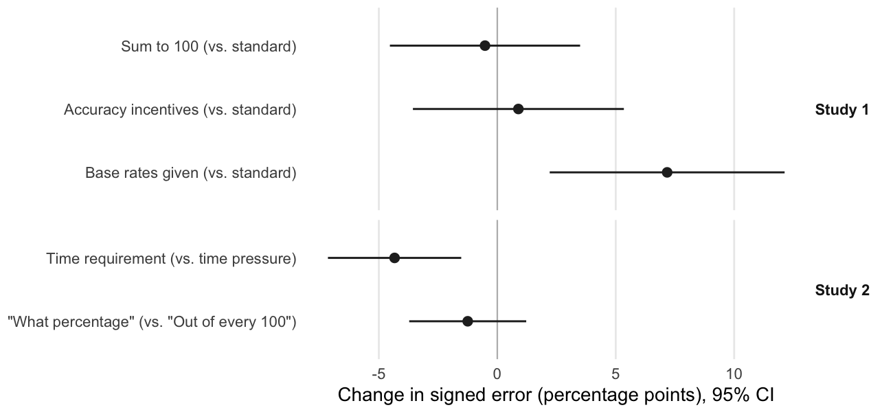

# Measuring Perceptions of Shares of Groups

Douglas J. Ahler and Gaurav Sood

[Paper](ms/main.pdf)

A corrected version of Ahler and Sood (2018), "Measuring Perceptions of Shares of Groups," in *Misinformation and Mass Audiences*, edited by Brian G. Southwell, Emily A. Thorson and Laura Sheble (University of Texas Press), pp. 71–90.

## Question

Surveys ask people what percentage of Democrats are Black, or what share of Americans were born abroad, and find large overestimates. Are those numbers beliefs, or artifacts of how the question is asked? The chapter lays out the threats: rushed versus considered answers, implicit denominators above 100, answers that express feelings rather than beliefs, and confusion between a group's share of a party and its share of the population. It then tests several of them.

## Design

Two Mechanical Turk surveys with embedded randomized experiments:

- **Study 1** (November 2014, 382 respondents): standard estimation of eight party-group shares, compared with a sum-to-100 constraint, accuracy incentives (5 cents per answer within 5 points), and sliders that start at the group's population share.
- **Study 2** (July 31, 2016, 596 respondents): a timing experiment (10-second limit versus a 15-second wait before answering) and a wording experiment ("What percentage" versus "Out of every 100"), which also asked about the diet-soda gender gap with and without first asking for the base rate.

The outcome is signed error, the reported share minus the true share. Pooled effects regress it on the treatment with item fixed effects and respondent-clustered standard errors. Party benchmarks and population base rates come from the 2012 ANES with the same coding.

## Findings



- Sum-to-100, incentives and "Out of every 100" leave the average error unchanged. The first and last move individual items in both directions. Sum-to-100 lowers the estimated share of Democrats who are Black by 7.8 points and raises the estimated share of Republicans who are Southern by 18.6 points.
- A 15-second wait lowers signed error by 4.3 points (95% CI 1.5 to 7.1), from 19.8 to 15.6. Answers do not pile up at the truth, so looking answers up explains little of the drop.
- Starting the sliders at the base rate raises error by 7.2 points. Asking for the diet-soda base rate first widens the perceived gender gap by 3.1 points (not significant).
- Respondents overestimate each group's population share, but they overestimate its share of the associated party by more. The difference-in-differences is significantly positive for five of eight groups. Black Democrats are the exception: there the overestimate of the population share is larger (−6.5, 95% CI −14.2 to 1.3).

## Corrections to the published chapter

- The share of the poor who are Black is 23.1%, not 24.5%. The old code's denominator counted only White, Black and Asian poor. The foreign-born share is the 2014 ACS figure (13.2%), not the 2010 figure (12.9%).
- The "What percentage" baseline is 17.7, not 18.9. The 18.9 was the regression constant, which corresponds to the "Out of every 100" condition.
- The test for looking answers up scored unseen items as wrong. Counting only items respondents saw gives 3.2% versus 5.0% on the nose (p = 0.07), not 2.2% versus 3.5%.
- The Black-Democrat difference-in-differences had a precedence bug (`x - 24 / 24`) that dropped the true shares, giving +4.6 instead of −6.5. Base rates now come from the ANES. The old ones mixed definitions: the 65+ share of everyone including children, and union members as a share of workers.
- The sum-to-100 condition's +18.6-point effect on the Southern item went unreported, and the K–S table attached its significant test to the 65+ row.
- Item-level significance in the timing experiment is three items at p < 0.05 and five at p < 0.1, not five and seven.
- Study 1 had four conditions, not five. Its sample table swapped Republicans (18.8%) and independents (22.3%).
- The Study 2 sample table described all 1,507 records, including a separate experiment, and gave 19.4% Latino. The 596 analyzed respondents are 5.4% Latino.
- The base-rates result no longer claims to show that representativeness drives perceptions; anchoring and conversational inference fit it too.

All pooled treatment effects reproduce the original Stata estimates; the tests pin them.

## Reproduce

With R 4.6, XeLaTeX and latexmk:

```sh
make restore   # install the package versions in renv.lock
make check     # analysis, figures, tables, manuscript, lint, tests
```

`make ci-docker` runs the same checks in `rocker/verse:4.6.0`. The build makes no network calls. Every number in the manuscript comes from `tabs/macros.tex`.

## Files

| Path | Contents |
|---|---|
| `data/study1_2014.csv` | Study 1: answers, base-rate estimates, full sum-to-100 allocations, page timers and demographics |
| `data/affect_2014.csv` | April 2014 survey: group thermometers and out-party share estimates |
| `data/study2_2016.csv` | Study 2, all three experiments fielded: timing (with page timers), wording, and the Bayesian-cues experiment reported in Ahler and Sood (2023) |
| `data/anes_2012.csv` | The ANES 2012 columns behind the party benchmarks and base rates |
| `data/codebook.md` | What every column in these files means, and where each file comes from |
| `data/benchmarks.csv` | Benchmarks not computed from the ANES, with sources |
| `data/answers_*.csv` | Long-format answers, derived by `scripts/01_prepare.R` |
| `R/` | Data shaping, estimators, exhibit helpers |
| `scripts/` | `00_extract.R` (manual: writes `data/` from soodoku/partisan_heads and soodoku/partisan_typecast), then `01_prepare.R`, `02_estimate.R`, `03_exhibits.R` |
| `tabs/`, `figs/` | Generated tables, figures and manuscript macros; `figs/study2_*.png` are screenshots of the Study 2 treatments |
| `docs/instrument_draft_2016_06.pdf` | A June 2016 draft of the Study 2 instrument; the fielded version differs |
